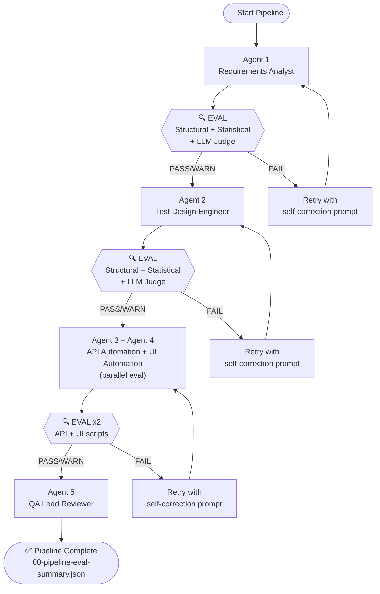

# Evals Design — InvenTree QE Agentic Pipeline

> **What are evals?**  
> Evals are automated quality gates that validate each AI agent's output *before* it's passed to the next agent in the pipeline. Without evals, garbage in becomes garbage out — a flawed requirements brief silently propagates into flawed test cases, flawed automation, and flawed reports.

---

## The Problem Evals Solve

```
Without Evals:                    With Evals:

Agent 1 ──────────────────────►  Agent 1 ─── EVAL ──► PASS ──►  Agent 2
[bad output]                               │
                                           ▼ FAIL
                                      Self-correct
                                      prompt injected
                                           │
                                           ▼ Retry
                                      Agent 1 ─── EVAL ──► PASS ──► Agent 2
```

---

## Three Eval Layers

Every agent output is evaluated through **three independent layers** that together provide deterministic + semantic quality assurance.

```
Agent Output
     │
     ▼
┌─────────────────────────────────────┐
│  Layer 1: Structural Eval           │  Fast, deterministic
│  • JSON schema validation           │  Catches: missing fields, wrong types,
│  • Required field presence          │  empty content, invalid enums
│  • Type checks                      │
└─────────────────┬───────────────────┘
                  │ passed? continue
                  ▼
┌─────────────────────────────────────┐
│  Layer 2: Statistical Eval          │  Fast, deterministic
│  • Coverage count checks            │  Catches: insufficient test cases,
│  • Pattern scans (secrets, locators)│  missing CRUD ops, hardcoded secrets,
│  • Ratio and distribution checks    │  no cleanup hooks, wrong locators
└─────────────────┬───────────────────┘
                  │ scored
                  ▼
┌─────────────────────────────────────┐
│  Layer 3: LLM-as-Judge              │  Slower, semantic
│  • Business rule quality            │  Catches: vague requirements, unclear
│  • Test step clarity                │  test steps, non-idiomatic code,
│  • Code idiom assessment            │  poor POM design, weak test data
│  • Holistic scoring                 │
└─────────────────┬───────────────────┘
                  │
                  ▼
           Merged EvalReport
```

---

## Eval Scoring

### Score Calculation

```
Final Score = (StatisticalScore × 0.30) + (LLMScore × 0.70)

If Structural FAIL → Final Score = 0.0 (automatic FAIL)
```

### Verdict Thresholds

| Score Range | Verdict | Pipeline Action |
|------------|---------|----------------|
| ≥ 0.85 | **PASS** ✅ | Continue to next agent |
| 0.65 – 0.84 | **WARN** ⚠️ | Continue, log warnings |
| < 0.65 | **FAIL** ❌ | Retry agent with self-correction |

### Blocking Issues (Auto-FAIL regardless of score)

- Required JSON schema fields missing or wrong type
- Agent violated "DO NOT" rules (e.g., generated code when told not to)
- Hardcoded credentials found in generated automation files
- P0 test cases not covered in generated automation

---

## Retry + Self-Correction

When an agent **FAILs** evaluation, the orchestrator:

1. Extracts the blocking issues and warnings from the `EvalReport`
2. Builds a **self-correction prompt** by appending the issues to the original prompt:
   ```
   --- IMPORTANT: SELF-CORRECTION REQUIRED ---
   Your previous output was evaluated and received verdict: FAIL (score: 0.52/1.0)

   You MUST fix the following issues before responding:

   BLOCKING ISSUES (must fix):
   • test_suite.total_cases (30) does not match actual array length (28)
   • Part Delete (FA-006) has only 5 API test cases — below minimum of 8

   WARNINGS (should fix):
   • No auth failure test for PATCH endpoint

   Please produce a corrected version now.
   ```
3. Retries the agent with the self-correction prompt
4. Re-evaluates the new output
5. Repeats up to **2 times** before proceeding with the best available output

---

## Eval Dimensions per Agent

### Agent 1 — Requirements Analyst

| Dimension | Weight | What's Checked |
|-----------|--------|---------------|
| Schema Compliance | 25% | JSON matches required schema exactly |
| Coverage Completeness | 30% | All 4 domains present (Category CRUD, Part CRUD, Search, Auth) |
| Business Rule Quality | 25% | Rules are specific and testable — not generic statements |
| Endpoint Accuracy | 10% | Endpoints match real InvenTree REST API paths |
| UI Flow Clarity | 10% | UI steps are numbered and unambiguous |

### Agent 2 — Test Design Engineer

| Dimension | Weight | What's Checked |
|-----------|--------|---------------|
| Schema Compliance | 15% | Test catalogue JSON schema valid |
| Count Adequacy | 25% | ≥8 API and ≥6 UI cases per CRUD operation |
| Scenario Diversity | 25% | Happy, boundary, negative, auth scenarios per area |
| Traceability | 15% | Every TC references a valid FA-xxx from Agent 1 |
| Test Data Quality | 10% | Test data realistic and boundary-aware |
| Priority Distribution | 10% | P0 cases for every functional area |

### Agent 3 — API Automation Engineer

| Dimension | Weight | What's Checked |
|-----------|--------|---------------|
| Schema Compliance | 10% | Files array structure is valid |
| Required Files | 20% | api-client.ts, playwright.config.ts, package.json, .env.example |
| Code Correctness | 25% | TypeScript syntax valid, imports logical |
| Security | 20% | No hardcoded credentials — all from `process.env` |
| Test Coverage | 15% | All P0 API test IDs have spec blocks |
| Best Practices | 10% | afterEach cleanup, test.step(), JSDoc present |

### Agent 4 — UI Automation Engineer

| Dimension | Weight | What's Checked |
|-----------|--------|---------------|
| Schema Compliance | 10% | Files array structure is valid |
| POM Structure | 25% | All 4 page classes with correct method contracts |
| Locator Quality | 20% | getByRole/getByLabel/getByTestId over CSS selectors |
| Security | 15% | No hardcoded credentials |
| Test Independence | 15% | Each test sets up and tears down via API |
| Assertion Quality | 15% | toHaveURL, toHaveTitle, toBeVisible assertions used |

---

## Eval Artefacts

Each pipeline run produces these eval files:

```
agent-artifacts/logs/
├── 00-pipeline-eval-summary.json     ← Overall pipeline verdict + all reports
├── 01-requirements-brief.json        ← Agent 1 output
├── 02-test-catalogue.json            ← Agent 2 output
├── 03-api-automation-output.json     ← Agent 3 output
├── 04-ui-automation-output.json      ← Agent 4 output
├── 05-quality-report.json            ← Agent 5 output
└── evals/
    ├── eval-requirements-analyst.json    ← Eval report: Agent 1
    ├── eval-test-design-engineer.json    ← Eval report: Agent 2
    ├── eval-api-automation-engineer.json ← Eval report: Agent 3
    └── eval-ui-automation-engineer.json  ← Eval report: Agent 4
```

### Pipeline Summary Schema

```json
{
  "pipelineRunId": "uuid-v4",
  "startedAt": "2026-09-29T19:00:00Z",
  "completedAt": "2026-09-29T19:08:00Z",
  "overallPipelineStatus": "PASS | WARN | FAIL",
  "agentReports": [ ...EvalReport ],
  "totalRetries": 1,
  "halted": false,
  "haltReason": null
}
```

---

## Updated Pipeline Architecture



---

## Files

| File | Purpose |
|------|---------|
| [`evals/eval-types.ts`](file:///c:/Users/uhanu/Workspace%20Github/case-study-inventree-google/submission/agents/evals/eval-types.ts) | Shared TypeScript types (`EvalReport`, `EvalDimension`, etc.) |
| [`evals/eval-runner.ts`](file:///c:/Users/uhanu/Workspace%20Github/case-study-inventree-google/submission/agents/evals/eval-runner.ts) | Core eval orchestrator — runs all 3 layers, merges scores, builds retry prompts |
| [`evals/agent1-evals.ts`](file:///c:/Users/uhanu/Workspace%20Github/case-study-inventree-google/submission/agents/evals/agent1-evals.ts) | Structural + statistical checks for Agent 1 |
| [`evals/agent2-evals.ts`](file:///c:/Users/uhanu/Workspace%20Github/case-study-inventree-google/submission/agents/evals/agent2-evals.ts) | Structural + statistical checks for Agent 2 |
| [`evals/agent3-evals.ts`](file:///c:/Users/uhanu/Workspace%20Github/case-study-inventree-google/submission/agents/evals/agent3-evals.ts) | Structural + statistical checks for Agent 3 |
| [`evals/agent4-evals.ts`](file:///c:/Users/uhanu/Workspace%20Github/case-study-inventree-google/submission/agents/evals/agent4-evals.ts) | Structural + statistical checks for Agent 4 |
| [`agent-06-eval-judge.md`](file:///c:/Users/uhanu/Workspace%20Github/case-study-inventree-google/submission/agents/agent-06-eval-judge.md) | LLM-as-Judge agent definition |

